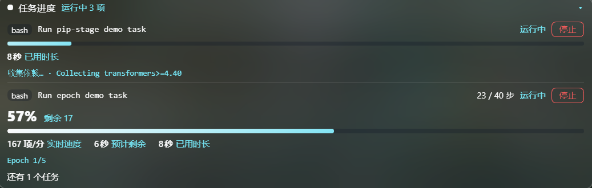

# dsh-task-progress · DSH 任务进度卡

[](https://github.com/Dekurri/dsh-task-progress/actions/workflows/ci.yml)
[](https://github.com/Dekurri/dsh-task-progress/releases)
[](./LICENSE)
[](./CONTRACT.md)

> 给 [DeepSeek Harness](https://github.com/deepseek-ai) 用的输入框浮动进度卡插件：正在跑的 `pip install`、`tqdm` 循环、
> 模型训练 epoch，会在输入卡上沿实时显示**进度条、百分比/分数、速度、预计剩余、已用时长**，并可一键停止。
> 纯前端实现，不轮询、不上报、不落盘。

`Topics: dsh-plugin · deepseek-harness · task-progress · tqdm · pip · training`



> 上图是插件在 DSH 里的真实运行截图（`demo/showcase.py` 与 epoch / pip 演示任务并发运行时的状态）。

```
输入卡上方（浮动层，不挤压输入框）
┌──────────────────────────────────────────────────────────────┐
│ ▸ 任务进度  运行中 1 项                          收起 / 全部 │
│   bash · python train.py                                     │
│   45 %  450 / 1000 项                            剩余 550    │
│   ████████████████░░░░░░░░░░░░░░░░░░░░░░░░░░░░░░░░░░░░░░░   │
│   1.2 it/s · 预计剩余 15秒 · 已用 14秒              [ 停止 ] │
└──────────────────────────────────────────────────────────────┘
```

## 特性

- **自动出现、自动消失**：只看当前会话里 `running` / `stopping` 的任务；没有运行中的任务时完全不渲染，不占位置。
- **推送式实时数据**：直接使用 DSH 内置 `jobs` 客户端服务（`job.list` 快照 + `job.follow` 输出流），
  输出边跑边解析，不是 1 秒轮询接口。
- **两种 bash 工具都覆盖**：内置 bash 工具和 `dsh-ops` 的 `ops_bash` 都把进程注册进同一个 `ctx.jobs`，
  前台调用（agent 正在等）和后台任务都能看到。
- **多格式解析**：tqdm 进度条、带标签的分数（`Epoch 3/10`、`step 120/1000`、`1/132 项`）、裸百分比 `45%`、
  pip 阶段（Collecting / Downloading / Installing / Building）；同一行既有 epoch 又有 step 时用更细的 step 当主进度，
  epoch 放进详情行。
- **会被算出来的三项指标**：速度（tqdm 自带 rate，或由分数增量/时间估算）、预计剩余（tqdm 的 `<mm:ss>`，
  或按已用时间外推）、已用时长（任务 `startedAt`）。
- **可停止**：两段确认（第一次点变成「再点一次停止」，3 秒未确认自动复位），走 DSH 的任务 kill 通道，
  停止中显示「停止中…」并且按钮禁用。
- **不打扰输入**：注册在 `conversation.input.overlay`，绝对定位悬浮在输入卡上沿上方，展开/收起**不改变输入框高度**；
  卡片内点击不会让输入框失焦。
- **多任务 + 折叠**：默认展开 2 个运行中任务，其余折叠为「还有 N 个」，可一键全部展开或整卡收起。
- **中英双语**：跟随 DSH 界面语言（`locale/en.json`、`locale/zh.json`）。
- **主题自适应**：全部使用 `--dsw-alias-*` / `--dsw-specific-*` 主题 token 并带 fallback，亮色/暗色都跟随；
  支持 `prefers-reduced-motion`。

## 安装

需要 **DSH 0.2.x**（插件使用 web 客户端的 `jobs` / `slots` / `locale` 服务；在 0.2.1-rc.5 上验证）。
插件本身**没有运行时第三方依赖**，`react` / `react-dom` 只是测试用 devDependencies。

三条路径任选（完整步骤、排错与验证清单见 [`INSTALL.md`](./INSTALL.md)）：

### 1. 从 Release 压缩包安装（不需要 git）

```sh
# 下载后将 tgz 解压到长期保存的目录（不要放临时目录：安装是符号链接，删掉源目录插件即失效）
mkdir -p ~/dsh-plugins && tar -xzf dsh-task-progress-0.1.1.tgz -C ~/dsh-plugins
```

然后在 DSH 插件管理器里按**绝对路径**安装解压出来的 bundle 目录（GUI 的插件管理界面，或让 AI 助手调用
`plugin_manager install_bundle`）。

### 2. 从源码安装（可 `git pull` 升级）

```sh
git clone https://github.com/Dekurri/dsh-task-progress.git ~/dsh-plugins/dsh-task-progress
cd ~/dsh-plugins/dsh-task-progress && npm install && npm run verify
```

同样用绝对路径 `~/dsh-plugins/dsh-task-progress` 安装 bundle。

### 3. 交给 DSH 里的 AI 助手

```
请把 https://github.com/Dekurri/dsh-task-progress 安装成 DSH 插件 bundle：
git clone 到 ~/dsh-plugins/dsh-task-progress，然后 plugin_manager install_bundle 的目标用这个绝对路径，
装完用 cordis_inspect_query 确认 conversation.input.overlay 里出现 id=task-progress，并跑 npm run verify。
```

> 插件管理器的 `install_bundle` 也接受 git 规格（如 `github:Dekurri/dsh-task-progress`），
> 这种装法升级时可重新拉取；本地目录装法则要自己 `git pull` 后刷新。

卸载：`plugin_manager remove_bundle`，target 为 `dsh-task-progress`。

## 演示

仓库自带一个不依赖任何库的演示脚本（只用 Python 标准库）：

```sh
# tqdm 风格的进度条
python3 demo/progress_demo.py --mode tqdm --seconds 24

# 训练日志风格：Epoch e/5 | step s/40 | loss ... | elapsed Ns
python3 demo/progress_demo.py --mode epoch --seconds 60

# pip 安装阶段（没有百分比，卡片显示阶段 + 不确定进度条）
python3 demo/progress_demo.py --mode pip

# 特征最全的一次跑法：tqdm -> epoch+step -> pip 阶段 -> 裸百分比 -> ANSI 彩色行
python3 demo/showcase.py --seconds 9
```

在 DSH 里让 agent 用 `bash` / `ops_bash` 跑上面任意一条（前台或后台都行），输入卡上沿就会出现卡片。
想看多任务折叠效果，可以同时跑三条（例如 `showcase.py` + epoch + pip）。

## 原理

```
浏览器 (client.js)                                Host（空实现 index.js）
┌──────────────────────────────────────────┐      ┌──────────────┐
│ conversation.input.overlay 槽位           │      │              │
│   TaskProgressDock                        │      │  export      │
│     ├─ watchRows(sessionId)  ── job.list ─┼─────▶│  function    │
│     └─ observe(sessionId, jobId) ─ follow ┼─────▶│  apply(){}   │
│            │                              │      └──────────────┘
│            ▼                              │         内置 jobs 服务
│   输出尾部 → parseProgressLine → analyzeJob│         （工具无关的进程注册表）
└──────────────────────────────────────────┘
```

- **不新造事件、不改 Host 契约**：进度全部来自内置 `jobs` 服务已经推送的输出流，插件只做解析和渲染；
  所以不会碰会话日志格式，也不需要额外权限。
- **只读当前会话**：`job.list` 以 `sessionId` 作为 owner 过滤条件，别的会话的任务不会串台。
- **前台任务只在运行期间可见**：DSH 内置 bash 工具在任务结束时把 job 从注册表移除（后台任务会保留），
  所以卡片会在命令返回的那一刻消失——这是预期行为。
- **解析只看输出尾部**：取最近约 12000 字符、按 `\r` / `\n` 切成行，从最后一行往前找最近的可用进度；
  这样多行日志、进度条被 `\r` 覆盖的情况都能处理。

### 解析规则

| 输入样例 | 识别结果 |
|---|---|
| ` 45%\|████▎     \| 450/1000 [00:12<00:15, 1.20it/s]` | tqdm：45%，450/1000，预计 15秒，1.2 it/s |
| `  0%\|          \| 0/132 [00:00<?, ?it/s]` | tqdm 刚启动：0%，0/132，暂无速度/ETA |
| `Epoch 3/10: loss=0.123` | 训练 epoch：30%（3/10） |
| `翻译进度 1/132 项` | 中文分数：0.76%（1/132 项） |
| `[step 120/1000] lr=1e-4` | step：12%（120/1000） |
| `Epoch 1/5 \| step 18/40 \| loss 2.28` | step 45%（18/40），详情行显示 `Epoch 1/5` |
| `Building wheel for torch (45%)` | 裸百分比 45%，阶段「构建中」 |
| `Log file written 2026/11/09` | 识别为日期，不算分数 |
| `Installing collected packages: numpy` | 阶段「安装中」，进度条走不确定动画 |

## 隐私与安全

- **不发网络请求**：没有 `fetch` / WebSocket / CDN，也不加载远程资源。
- **不落盘**：没有配置文件、缓存目录或日志；任务输出只存在于浏览器内存（DSH 自己的 `jobs` 状态里）。
- **不读取凭据**：不读环境变量、cookie、token、会话日志。
- **不做 DOM 侵入**：不 append `document.body`、不用 iframe、不改别人的 DOM；只在自己的 React 组件里渲染
  `style` 标签（卸载时自动消失）。
- **可审计的依赖面**：运行时零依赖，devDependencies 仅 React（测试渲染用）。

## 护栏（仓库自带）

本仓库把「DSH 插件不能踩的坑」写成了可执行检查，`npm run verify` 一条命令全跑：

| 检查 | 说明 |
|---|---|
| `scripts/static-check.mjs` | 清单字段（`dsh.bundle.patch`、`dsh.client.inject`、exports）、`index.js` 导出、patch 的 insert 行、client 工厂 id 与包名一致、只用 `require("react")`、不 require `@deepseek-ai/dsh-client-*`、槽位是 `conversation.input.overlay`、无 iframe/`document.body`/fetch、主题 token 白名单、locale `meta`、图标 ≤256 KiB、文档齐全 |
| `scripts/secret-scan.mjs` | 私钥块、OpenAI/GitHub/AWS/Slack/Google 形态的 key、Bearer/口令赋值、Windows/Unix/macOS 用户绝对路径 |
| `test/parse.test.mjs` | 直接从发布用的 `client.js` 抽解析段执行，覆盖 tqdm/epoch/step/中文分数/百分比/pip 阶段/日期/ANSI/ETA/速度等断言 |
| `test/render.test.mjs` | 用 React 18 SSR 渲染真实组件，断言槽位元数据、字典注册、空态、tqdm 卡、pip 不确定态、stopping 态、全部 `t()` key 双语覆盖 |
| `.github/workflows/ci.yml` | push / PR 全量跑上面的检查 + `node --check` + `npm pack --dry-run` |
| `.github/workflows/release.yml` | 打 `v*` tag 时重新跑检查、校验 tag 与 `package.json` 版本一致、`npm pack` 并创建 Release |
| `CODEOWNERS` / 分支保护 | 合入需要通过 CI（`verify bundle`），禁止强推/删除 main（见 INSTALL.md 的「发布流程」） |
| `dependabot.yml` | 每周检查 devDependencies 与 GitHub Actions 更新 |

## 兼容性

- **DSH 0.2.x**，在 `0.2.1-rc.5` 上验证（`jobs` / `slots` / `locale` 客户端服务）。
- 依赖的客户端模块在 `package.json` 的 `dsh.client.inject` 里声明：
  `@deepseek-ai/dsh-api-job-controller`、`@deepseek-ai/dsh-client-locale`、`@deepseek-ai/dsh-client-ui-conversation`。
- 如果 DSH 更换了 `job.*` 的远端帧格式或 `jobs` 客户端服务名，插件需要同步升级（见 [`CONTRACT.md`](./CONTRACT.md)）。

## 仓库结构

```
dsh-task-progress/
├─ client.js              # 插件全部实现（槽位、解析、卡片 UI、主题样式）
├─ index.js               # Host 半部：空实现，进度数据来自内置 jobs 客户端服务
├─ cordis.patch.yml       # bundle 声明：insert task-progress
├─ locale/{en,zh}.json    # 插件管理界面显示名/描述
├─ icon.svg               # 插件图标
├─ demo/progress_demo.py  # 无依赖演示脚本（tqdm / epoch / pip）
├─ demo/showcase.py       # 一次跑完所有解析格式的演示脚本
├─ test/                  # 解析单测 + React SSR 渲染测试
├─ scripts/               # static-check（插件护栏）+ secret-scan
├─ docs/preview.png       # README 预览图（插件真实运行截图）
├─ .github/               # CI、Release、Dependabot、Issue/PR 模板、CODEOWNERS
├─ CONTRACT.md            # 与 DSH 的集成契约与版本风险
├─ INSTALL.md             # 三种安装路径 + 发布流程 + 排错
├─ AGENTS.md              # 给 AI 助手的维护须知
├─ CONTRIBUTING.md        # 贡献流程
├─ SECURITY.md            # 安全策略与报告方式
├─ CHANGELOG.md           # 版本记录
└─ LICENSE                # MIT
```

## 开发

```sh
npm install       # 只有测试需要（React SSR）
npm run verify    # static-check + secret-scan + 解析单测 + 渲染测试
npm run pack:check
```

改完 `client.js` 后**不需要重新安装**（link 安装直接指向源码目录），刷新 DSH 页面即可生效。

## 已知限制

- 解析是**启发式**的：只覆盖常见 tqdm / pip / 训练日志格式；自定义进度输出需要扩展 `STAGE_RULES` 或正则。
- 只在**当前会话**显示；跨会话、历史任务不展示（`job.list` 按 session 过滤）。
- 前台任务结束即从注册表移除，卡片同时消失——不会保留「已完成」记录。
- 卡片不是终端：只显示最后一行/阶段文本，不提供完整输出滚动（完整输出仍在原本的工具卡片里）。
- 依赖 DSH 内部客户端服务，属于**跟随 DSH 版本**的插件；升级 DSH 后如卡片不渲染，优先看 `CONTRACT.md` 的兼容性检查清单。

## 协议

[MIT](./LICENSE) © 2026 Dekurri
